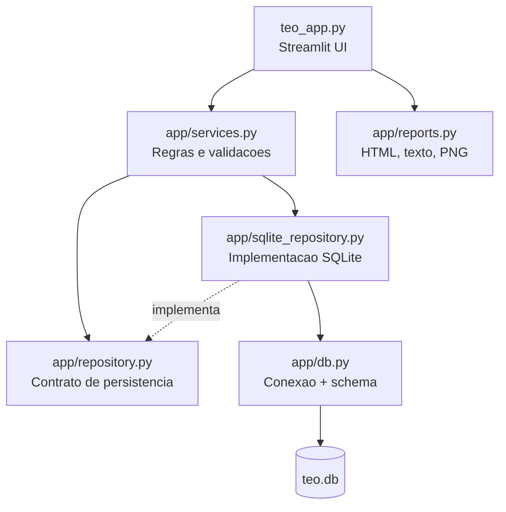

# Arquitetura Atual

## Visao geral
A aplicacao segue uma arquitetura simples em camadas:
- UI em Streamlit
- Services para regra de negocio
- Repository para persistencia
- SQLite como armazenamento local
- Reports para exportacoes

## Diagrama

## Componentes e responsabilidades
| Arquivo | Responsabilidade |
|---|---|
| `teo_app.py` | Tabs principais, formularios, selecao de alertas, dialog de visualizacao e downloads |
| `app/services.py` | Criacao/atualizacao/remocao de alerta e acionamento; validacao de campos obrigatorios |
| `app/repository.py` | Interface `AlertasRepository` usada pelos services |
| `app/sqlite_repository.py` | CRUD de alertas e acionamentos, busca por ticket, calculo de status atual |
| `app/db.py` | Inicializacao do banco, criacao de tabelas e migracoes de colunas |
| `app/reports.py` | `gerar_html_final`, `gerar_resumo_texto`, `gerar_imagem_resumo_png`, `gerar_imagem_timeline_png` |

## Fluxo principal da aplicacao
1. `teo_app.py` chama `init_db()` ao iniciar.
2. Usuario cria alerta na aba "Registrar Novo Alerta".
3. `services.criar_alerta()` valida e persiste via repository.
4. Usuario adiciona acionamentos na area de gestao do ticket.
5. `services.adicionar_acionamento()` persiste acionamento.
6. `sqlite_repository` calcula `status_atual` com base no ultimo `status_acionamento`.
7. Usuario gera visualizacao/exportacao pela UI.

## Integracoes externas
| Integracao | Uso atual |
|---|---|
| Streamlit | Interface web e componentes |
| SQLite | Persistencia local em arquivo |
| Pillow (PIL) | Geracao de imagem PNG |

Nao ha integracoes com APIs externas, filas ou servicos de terceiros no codigo atual.
